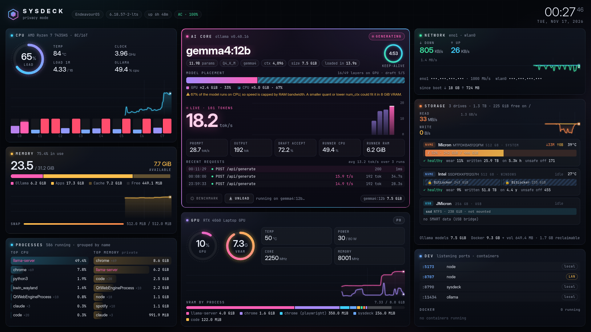

# SYSDECK

**A full-screen system monitor for your second screen, built for people running local LLMs with [Ollama](https://ollama.com) while they code.**

SYSDECK shows CPU, memory, GPU, storage, network and your dev servers at a glance. Its centerpiece is a live **AI Core** panel that shows what your model is actually doing: how much of it fits in VRAM, live tokens per second, prompt processing, speculative-decoding acceptance and every request.



<sub>Screenshot taken in privacy mode while `gemma4:12b` was generating on an RTX 4060 Laptop GPU (8 GB).</sub>

## Features

**AI Core (Ollama)**
- Loaded model, parameters, quantization, context size, load time and a keep-alive countdown
- **Model placement**: how many layers are on the GPU vs the CPU (read from Ollama's runner log), with a hint when a model spills into system RAM
- **Live tokens/s** while generating, prompt-processing progress, and a per-request throughput chart
- Speculative decoding (draft model) acceptance rate, runner CPU and RAM use
- Recent API requests with tokens, speed and duration
- One-click **Benchmark** and **Unload** (frees VRAM)

**System**
- CPU: load ring, temperature, clock, history chart, per-core heat bars
- Memory: Ollama / apps / cache / free breakdown, swap
- GPU (NVIDIA): utilization, VRAM, temperature, power, clocks, **VRAM per process**
- Storage: every drive with a **partition map** (mounted usage, BitLocker/LUKS, unmounted volumes), live read/write and temperature per drive, and **NVMe health** (wear, TB written, power-on hours, errors). Also shows Ollama model and Docker disk usage.
- Network: up/down chart, interfaces, IPs, VPN indicator
- Dev: listening ports with the **project folder** of each dev server, LAN-exposed ports highlighted, Docker containers
- Top processes by CPU and by private memory, grouped by name
- Alerts for high temperatures, low RAM, full VRAM and full disks
- **Media**: now playing with cover art, seekable progress, play/pause, next/previous, shuffle, repeat and volume for **any player**: Spotify, YouTube or any other tab in Firefox/Chrome/Chromium, VLC, mpv, Rhythmbox, Elisa, Strawberry... (anything that speaks MPRIS). It follows whichever player started last; click a player's name to pin it.

**App**
- Native desktop app (PyQt6) with a tray icon, not a browser tab
- Opens full-screen on the monitor you choose and remembers it
- Zoom (Ctrl +/−/0 or tray menu) with a compact layout for small or high-zoom screens
- **Resizable**: press F11 (or untick Full screen in the tray) for a normal window that remembers its size. The layout goes to two columns below ~1100 px and one column below ~700 px (CSS pixels, so zoom counts too), and nothing is cut off: any panel or list with more data than fits scrolls.
- **Privacy mode** hides host name, IP addresses and project folders, which is handy for screen sharing and screenshots
- Lightweight: no telemetry, no network access beyond `127.0.0.1`, except downloading the cover art your media player points to (e.g. Spotify's image CDN). Animations are tuned so the dashboard costs roughly 10–20% of one CPU core.

## Requirements

- Linux (tested on Arch/EndeavourOS with KDE Plasma 6 on Wayland; X11 and other desktops should work)
- Python 3.10+
- `psutil`, `PyQt6`, `PyQt6-WebEngine`

Optional, each one lights up more of the dashboard:

| Tool | Used for |
|---|---|
| `nvidia-smi` (NVIDIA driver) | GPU panel. AMD/Intel GPUs aren't supported yet. |
| Ollama running as the systemd service `ollama` | AI Core panel |
| Read access to the systemd journal | live tok/s, layer offload, request timings |
| `udisks2` | drive health (wear, TB written, power-on hours) |
| `docker` | containers list and Docker disk usage |
| `busctl` (systemd) + a session D-Bus | Media panel (MPRIS). mpv needs the `mpv-mpris` plugin. |

## Install

```bash
git clone https://github.com/arshiarasekhizadeh/sysdeck.git
cd sysdeck
./install.sh --autostart      # drop --autostart if you don't want it at login
```

The installer checks dependencies and tells you exactly what to install if something is missing:

```bash
# Arch / EndeavourOS / Manjaro
sudo pacman -S python-psutil python-pyqt6 python-pyqt6-webengine
# Debian / Ubuntu 24.04+
sudo apt install python3-psutil python3-pyqt6 python3-pyqt6.qtwebengine
# Fedora
sudo dnf install python3-psutil python3-pyqt6 python3-pyqt6-webengine
# Anything else (inside a venv)
pip install -r requirements.txt
```

Everything installs into your home directory (`~/.local`), so no root is needed.

**Live tokens/s needs journal access.** If the installer warns that it can't read the Ollama journal, run:

```bash
sudo usermod -aG systemd-journal $USER   # then log out and back in
```

### Run without installing

```bash
./bin/sysdeck                  # native app, straight from the source tree
python3 sysdeck/server.py      # or only the backend, then open http://127.0.0.1:8790 in a browser
```

## Usage

```
sysdeck            start, or show the running window
sysdeck toggle     show / hide
sysdeck hide       hide to tray
sysdeck restart    restart
sysdeck quit       quit
sysdeck logs       follow the log (~/.local/state/sysdeck/app.log)
```

**Tray menu:** show/hide, pick the **screen**, full-screen, **zoom**, privacy mode, reload, quit.
Closing the window hides it to the tray.

**Keys:** `F11` full-screen · `Ctrl` `+` / `-` / `0` zoom · `Ctrl+R` reload · `Ctrl+W` hide · `Ctrl+Q` quit

## Configuration

Settings are saved automatically to `~/.config/sysdeck/config.json` when you change them from the tray:

```json
{
  "screen": "HDMI-A-1",
  "fullscreen": true,
  "zoom": 1.25,
  "privacy": false,
  "port": 8790
}
```

| Key | Meaning |
|---|---|
| `screen` | Output name to open on (`HDMI-A-1`, `eDP-1`, `DP-2`…). Empty = the first non-primary screen. |
| `zoom` | 1.0 = 100%. Above 100% the compact layout kicks in. |
| `privacy` | Hide host name, IPs and project folders. |
| `port` | Local port for the built-in backend (the next free port is used if taken). |

Environment variables: `SYSDECK_PORT`, `SYSDECK_OLLAMA` (default `http://127.0.0.1:11434`), `SYSDECK_OLLAMA_UNIT` (systemd unit name, default `ollama`).

## How it works

```
app.py  ── PyQt6 window + tray, single instance, screen/zoom placement
  └─ server.py  ── in-process backend (stdlib + psutil), 127.0.0.1 only
        ├─ psutil ............ CPU, memory, processes, ports, network, disk I/O
        ├─ nvidia-smi -lms ... GPU stats (one long-running process)
        ├─ Ollama HTTP API ... loaded models, installed models
        ├─ journalctl -f ..... Ollama runner log → layer offload, prefill, live tok/s, timings
        ├─ lsblk + UDisks2 ... drives, partitions, NVMe health (no root)
        ├─ docker ............ containers, disk usage
        └─ busctl --user ..... MPRIS media players: now playing + controls
     → Server-Sent Events → static/ (HTML, CSS, canvas charts)
```

Ollama's `/api/ps` is polled sparingly, because every API call is written to Ollama's log. Most live data comes from following the journal instead.

## Uninstall

```bash
./uninstall.sh            # keep settings
./uninstall.sh --purge    # also remove settings and logs
```

## Troubleshooting

- **AI Core says "offline"**: is Ollama running on `127.0.0.1:11434`? Set `SYSDECK_OLLAMA` if it's elsewhere.
- **No live tok/s or "layers on GPU"**: your user can't read the journal (see Install), or Ollama doesn't run as the `ollama` systemd unit (set `SYSDECK_OLLAMA_UNIT`). Log formats can change between Ollama versions, so please open an issue with a few lines of `journalctl -u ollama` if parsing breaks.
- **Window opens on the wrong monitor**: pick it from the tray → Screen, or set `screen` in the config.
- **Blank or white window**: QtWebEngine failed to start. Run `sysdeck logs`; on some setups `QTWEBENGINE_CHROMIUM_FLAGS=--disable-gpu sysdeck` helps.

## License

[MIT](LICENSE)
